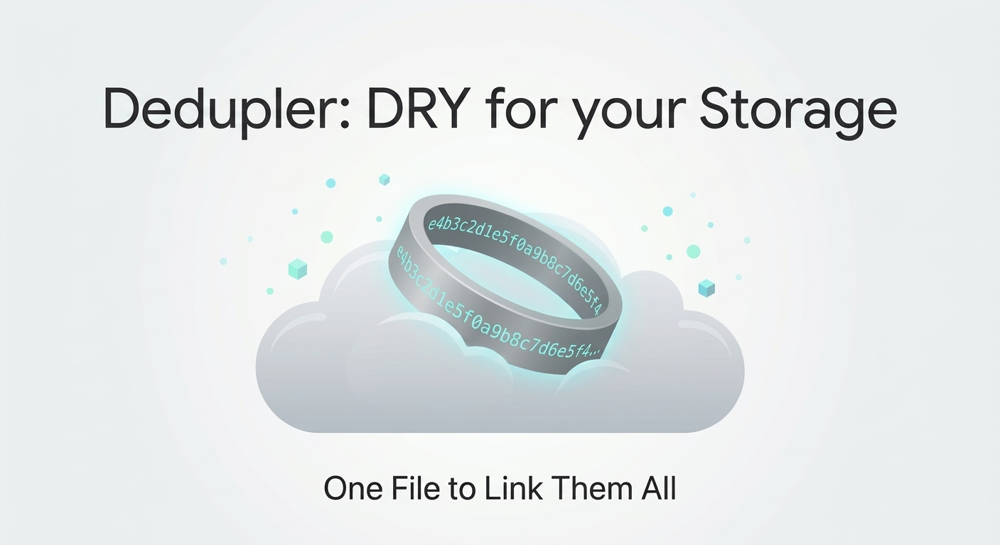

# Dedupler - Laravel package to prevent file duplications

[](https://packagist.org/packages/maxkhim/laravel-storage-dedupler)
[](https://laravel.com)
[](https://packagist.org/packages/maxkhim/laravel-storage-dedupler)
[](https://packagist.org/packages/maxkhim/laravel-storage-dedupler)

### Stop storing duplicate files in your Laravel application.

Tired of seeing the same file stored multiple times? When users upload duplicates, your storage bloats, cloud bills grow, backups take longer, and data consistency suffers.

**Dedupler** is an elegant Laravel package that solves this once and for all. It automatically prevents file duplicates using SHA-1 hashing and provides a beautiful polymorphic API to manage your attachments.

## ✨ Why Dedupler?

- ⚡ **Laravel Native** — Drop-in integration with your existing Eloquent models and Storage drivers.
- 🚫 **True Deduplication** — SHA-1 hashing guarantees exactly one physical copy per file.
- 🔗 **Polymorphic Magic** — Link a single physical file to multiple models effortlessly.
- 💾 **Storage & Cost Saver** — Slash your disk usage and speed up your backups.
- 🎯 **Developer-First API** — Clean, intuitive methods that just work out of the box.

## 🚀 Quick Start

### 1. Install via Composer
```bash
composer require maxkhim/laravel-storage-dedupler
```

####  (Optional) Analyse legacy storage directory 

Finds duplicate files by SHA1 hash in directory and subdirectories and calculate potential disk space savings

```bash
php artisan dedupler:analyse-legacy /absolute/path/to/legacy/storage/directory
```

### 2. Init package

This command make all necessary migrations,
and verifies application configuration (storage, models, etc.) to ensure the package is ready to use
```bash
php artisan dedupler:install
```

## 🔧 How to use

### 1. Use Facade Dedupler to Store Deduplicated files

```php
/** @var \Illuminate\Http\UploadedFile $file */
/** @var \Maxkhim\Dedupler\Models\UniqueFile $uniqueFile */
$uniqueFile = Dedupler::storeFromUploadedFile($file);
```

```php
/** @var string $absolutePathToFile */
/** @var \Maxkhim\Dedupler\Models\UniqueFile $uniqueFile */
$uniqueFile = Dedupler::storeFromPath($absolutePathToFile);
```

```php
/** @var string $fileContent */
/** @var \Maxkhim\Dedupler\Models\UniqueFile $uniqueFile */
$uniqueFile = Dedupler::storeFromContent($content, 'direct_content_file.ext');
```

### 2. Add Trait to Your Model to keep deduplicated files attached to models

```php
<?php

namespace App\Models;

use Illuminate\Database\Eloquent\Model;
use Maxkhim\Dedupler\Traits\Deduplable;

class Post extends Model
{
    use Deduplable;
}

$post = new Post([...]);
```

```php
/** @var \Illuminate\Http\UploadedFile $file */
/** @var \Maxkhim\Dedupler\Models\UniqueFile $uniqueFile */
$uniqueFile = $post->storeUploadedFile($file);
```

```php
/** @var \Maxkhim\Dedupler\Models\UniqueFile $uniqueFile */
$uniqueFile = $post->storeLocalFile($absolutePathToFile);
```

```php
/** @var \Maxkhim\Dedupler\Models\UniqueFile $uniqueFile */
$uniqueFile = $post->storeContentFile($content, 'direct_content_file.ext');
```

#### About Deduplication

When you upload the same file multiple times:

```php
// First upload - file is stored
$file1 = $post->storeUploadedFile($sameFile);
OR
$file1 = Dedupler::storeFromUploadedFile($sameFile);
// Second upload - returns existing UniqueFile, no duplicate created
$file2 = $post->storeUploadedFile($sameFile);
OR
$file2 = Dedupler::storeFromUploadedFile($sameFile);

$file1->id === $file2->id; // true - same database record and same file in storage
```

### 3. Attach existing files to models by SHA1 hash

If you already know the SHA-1 hash of a file (e.g., from a previous upload or an API response), you can attach it directly to any model without re-uploading the file.

> Note: The file must already exist in the Dedupler storage.

```php
// Using the trait on your model
$post->attachUniqueFile($sha1_hash);

// Or via the Facade
Dedupler::attach(string $fileHash, Model $model, array $pivotAttributes = []);
```

### 4. Detach unique files from models
Remove the association between a model and a file. 
The physical file remains in storage and is only deleted when no other models reference it (depending on your garbage collection settings).
```php
// Using the trait
$post->detachUniqueFile($sha1_hash);

// Or via the Facade
Dedupler::detach(string $fileHash, Model $model);
```


### Ecosystem

Dedupler is designed to integrate seamlessly with popular Laravel packages. Here are the integration:

- [Filament Plugin](https://github.com/maxkhim/filament-dedupler-uploader) A ready-to-use Filament form component for deduplicated file uploads.

### 🧹 Zero-Maintenance Cleanup (Enabled by Default)

You don't need cron jobs or manual scripts to keep your storage clean.

**By default, Dedupler automatically deletes the physical file when the very last model detaches it.** This guarantees you never pay for "ghost files" left behind after a user or post is deleted. If multiple models share the same file, it stays safely in storage until the last link is broken.

Prefer to handle cleanup manually via the `dedupler:prune` command? You can easily disable this auto-delete behavior via an environment variable:

```dotenv
DEDUPLER_REMOVE_ORPHAN_ON_DETACH=false
```

## 🧹 Keeping Your Storage Lean

Deduplication is only half the battle. When you delete a model (like a Post or User), the physical file might remain in your storage, becoming an "orphan". Over time, these orphaned files silently eat up your disk space.

Dedupler ships with a powerful, garbage collector to keep your storage perfectly clean:

```bash
# Example: Always preview what will be deleted (Safe mode)
php artisan dedupler:prune --orphan-relations --orphan-files --dry-run
```

## ❤️ Support the Project

If Dedupler saved you disk space, cloud costs, or just a few hours of debugging, consider giving the repository a star ⭐. It’s the best way to show your appreciation and help other developers discover this package. Also, you can make an issue.

## 🛣️ API Reference

### Enable RESTapi endpoint to check file existence

```dotenv
DEDUPLER_REST_ENABLED=true
```

```http request
GET http://localhost:8080/api/dedupler/v1/files/da39a3ee5e6b4b0d3255bfef95601890afd80709
```

```json
{
	"success": true,
	"data": {
		"hash": "da39a3ee5e6b4b0d3255bfef95601890afd80709",
		"sha1_hash": "da39a3ee5e6b4b0d3255bfef95601890afd80709",
		"md5_hash": "d41d8cd98f00b204e9800998ecf8427e",
		"exists": false,
		"filename": "da39a3ee5e6b4b0d3255bfef95601890afd80709.pdf",
		"path": "da\/39\/da39a3ee5e6b4b0d3255bfef95601890afd80709.pdf",
		"mime_type": "application\/pdf",
		"size": 102400,
		"size_human": "100 KB",
		"disk": "deduplicated",
		"status": "completed",
		"created_at": "2025-10-22T18:40:41.000000Z",
		"updated_at": "2025-10-22T18:40:41.000000Z",
		"links_count": 94
	}
}
```

## License

The MIT License (MIT).